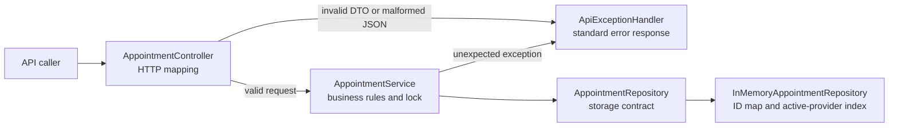
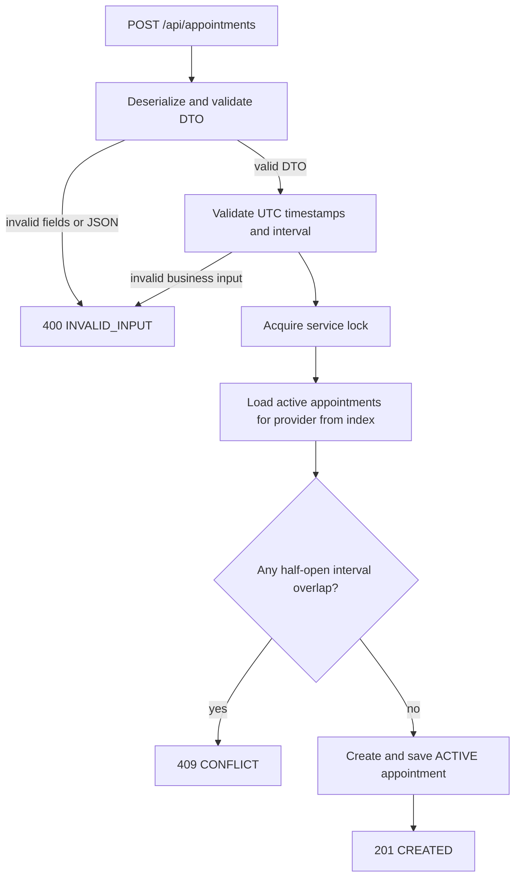
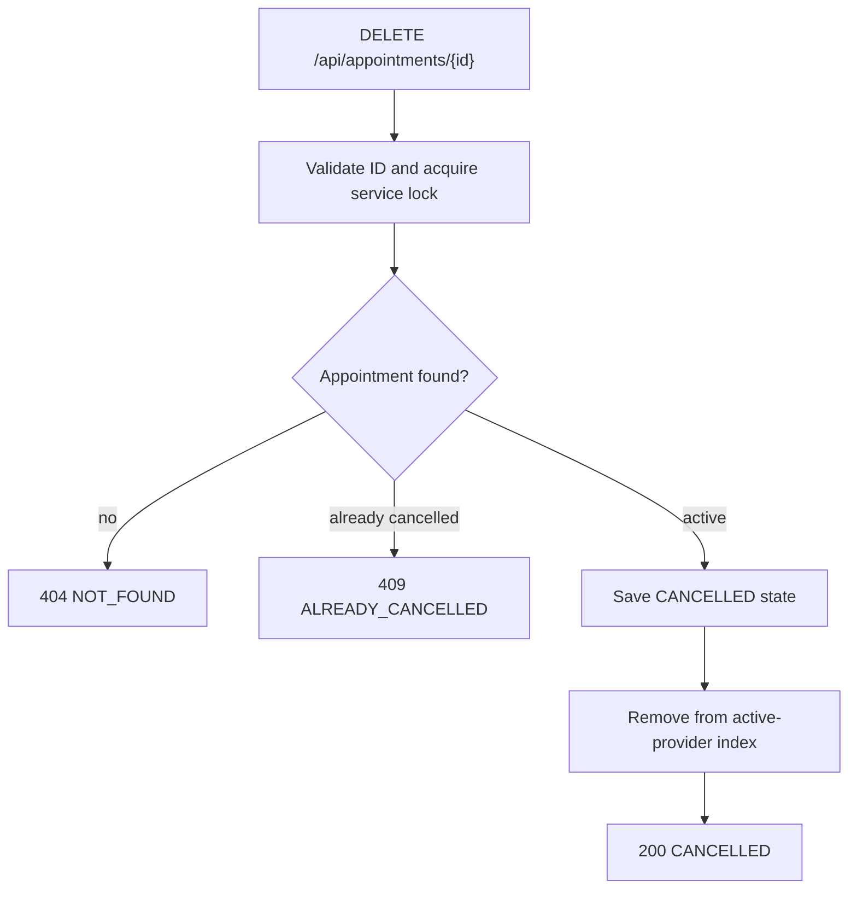

# Appointment Booking: End-to-End Developer Walkthrough

## 1. What the Application Does

This Spring Boot application exposes two operations: book an appointment for a provider and cancel an existing appointment. Its central rule is:

> A provider cannot have two active appointments whose time intervals overlap.

Appointments use UTC instants and half-open intervals `[start, end)`. The start is included and the end is excluded, so 09:00-10:00 and 10:00-11:00 are adjacent and allowed.

Persistence is currently in memory. There is no JPA or external database, so appointments disappear when the application stops.

## 2. Package Structure

```text
com.example.scheduling
|-- AppointmentBookingApplication.java
|-- controller
|   `-- AppointmentController.java
|-- dto
|   |-- BookingRequest.java
|   |-- BookingResponse.java
|   `-- CancellationResponse.java
|-- model
|   `-- Appointment.java
|-- repository
|   |-- AppointmentRepository.java
|   `-- InMemoryAppointmentRepository.java
`-- service
    |-- AppointmentService.java
    |-- BookingResult.java
    `-- CancelResult.java
```

The layers have focused responsibilities:

- `AppointmentBookingApplication` starts Spring Boot and registers the repository and service beans.
- `controller` translates HTTP requests into service calls and service results into HTTP responses.
- `dto` contains the JSON request and response shapes used by the API.
- `model` contains the appointment data and its state/time behavior.
- `repository` defines the storage contract and provides the in-memory implementation.
- `service` validates requests and enforces booking and cancellation rules.

The controller depends on the service, and the service depends on the repository interface. The business rule is not duplicated in the controller.

### Architecture and Request Flows







## 3. Application Startup and Dependency Wiring

The process starts in `AppointmentBookingApplication.main`:

```java
SpringApplication.run(AppointmentBookingApplication.class, args);
```

`@SpringBootApplication` enables Spring Boot configuration and scans the `com.example.scheduling` package and its subpackages. The two `@Bean` methods create:

1. An `InMemoryAppointmentRepository`, exposed through the `AppointmentRepository` interface.
2. An `AppointmentService`, constructed with that repository.

Spring injects the service into `AppointmentController`. Spring Boot starts the embedded web server on port 8080 by default.

## 4. Booking Request: HTTP to Storage

The caller sends:

```http
POST /api/appointments
Content-Type: application/json

{"providerId":"dr-a","startUtc":"2030-01-01T09:00:00Z","endUtc":"2030-01-01T10:00:00Z"}
```

### Controller

`AppointmentController.book` receives a `BookingRequest` DTO. Spring validates its required and maximum-length fields before the controller calls `AppointmentService.book`; the controller then maps the service status to an HTTP status:

| Service result | HTTP status |
|---|---|
| `BOOKED` | `201 Created` |
| `CONFLICT` | `409 Conflict` |
| `INVALID_INPUT` | `400 Bad Request` |

It returns a `BookingResponse` with the result status, appointment when booked, and message.

### Service validation

`AppointmentService.book` validates before reading or writing the repository:

1. `providerId` must not be null, empty, or whitespace-only.
2. Both timestamps must be non-blank ISO-8601 UTC strings ending in `Z`.
3. Both values must parse as `Instant`.
4. The end must be after the start.

Any validation failure returns `INVALID_INPUT` and does not change stored appointments.

### Atomic conflict check

For valid input, the service acquires its `ReentrantLock`. It asks `findActiveByProvider(providerId)` for that provider's active appointments, then checks each using:

```java
existing.start.isBefore(requested.end)
    && requested.start.isBefore(existing.end)
```

This means the intervals overlap only when each starts before the other ends. Equal endpoints are therefore adjacent, not a conflict. The repository query filters out other providers and cancelled appointments before this comparison.

The provider-keyed index avoids scanning appointments belonging to every provider. The overlap check remains linear in the active appointments for the requested provider, and the global service lock still serializes operations across providers.

If an overlap exists, the service returns `CONFLICT` without saving. Otherwise, it creates an `ACTIVE` appointment with a UUID, saves it through the repository, and returns `BOOKED`. A `finally` block releases the lock on every path.

### Repository write

`InMemoryAppointmentRepository.save` stores the appointment in a `LinkedHashMap`, keyed by appointment ID. Its active-provider query filters records by exact provider ID and active state.

A successful response has this general JSON shape:

```json
{
  "status": "BOOKED",
  "appointment": {
    "id": "generated-uuid",
    "providerId": "dr-a",
    "start": "2030-01-01T09:00:00Z",
    "end": "2030-01-01T10:00:00Z",
    "state": "ACTIVE"
  },
  "message": "Appointment booked"
}
```

## 5. Cancellation Request: HTTP to Storage

The caller uses the ID returned by booking:

```http
DELETE /api/appointments/{appointmentId}
```

The controller calls `AppointmentService.cancel` and maps results as follows:

| Service result | HTTP status |
|---|---|
| `CANCELLED` | `200 OK` |
| `NOT_FOUND` | `404 Not Found` |
| `ALREADY_CANCELLED` | `409 Conflict` |
| `INVALID_INPUT` | `400 Bad Request` |

The service validates that the ID is non-blank, acquires the same lock, and looks up the appointment. A missing ID returns `NOT_FOUND`; a record already marked cancelled returns `ALREADY_CANCELLED`. Otherwise, `Appointment.cancelled()` creates a new immutable record with the same ID, provider, and interval but state `CANCELLED`, which the repository saves under the same ID.

Cancelled records are retained so the service can distinguish a repeat cancellation from an unknown ID. Since the booking query returns active records only, cancelling frees the time for another booking.

## 6. Concurrency and Its Boundary

The service lock keeps the read-check-write sequence atomic for callers sharing this `AppointmentService` instance in one JVM. Without it, simultaneous requests could both observe an open slot and both save.

This is not a cross-process guarantee. Separate application instances do not share the Java lock. If the application later uses multiple instances, the database must enforce the invariant using a transaction and a database constraint or provider-level locking.

## 7. Tests and Verification

`AppointmentServiceTest` covers booking success, overlap shapes, adjacency, provider isolation, cancellation and rebooking, invalid input, and concurrent booking attempts. `AppointmentControllerTest` uses MockMvc to exercise the HTTP routes and status mappings.

The last clean test run reported 30 tests, 0 failures, 0 errors, and 0 skipped:

```bash
mvn clean test
```

Run the web application with:

```bash
mvn spring-boot:run
```

## 8. Assumptions and Limitations

- Timestamps must be UTC instants ending in `Z`; numeric offsets are rejected rather than converted.
- Past appointment times are permitted.
- Provider IDs are opaque and compared exactly, including case and whitespace.
- Data is held in memory and is lost on restart.
- One global lock serializes operations for all providers.
- There is no authentication or authorization in this bounded service.
- Request DTO constraints reject blank and oversized fields. `ApiExceptionHandler` returns consistent responses for invalid request bodies and unexpected failures without exposing exception details to callers.
- The provider index is an in-memory optimization only; a multi-instance deployment still needs database-backed consistency and authorization appropriate to its callers.
- JPA and database persistence are not included; the repository interface is the boundary where a later implementation can be added.
